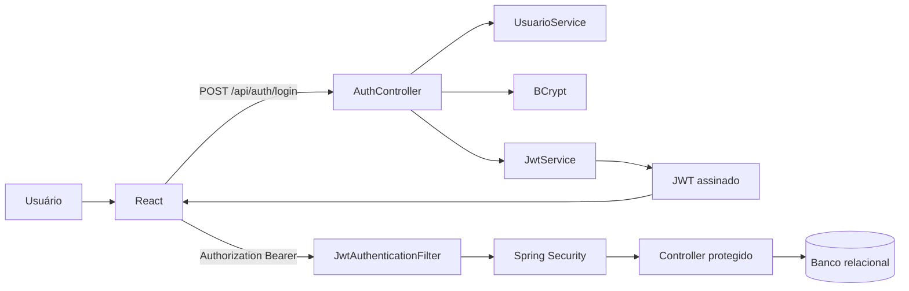
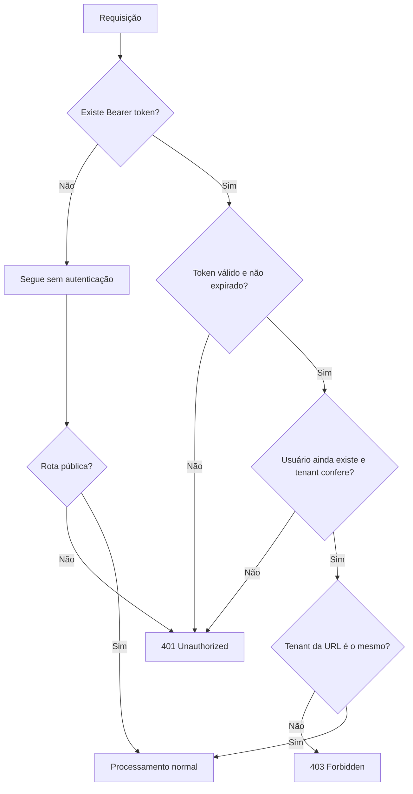

# Implementação de Segurança com Spring Security

## 1. Implementação de Segurança com Spring Security

Esta etapa do Projeto Integrador ImobFiscal acrescentou uma camada de proteção à API REST desenvolvida em Java 17 e Spring Boot 3.3. A mudança foi realizada na disciplina Desenvolvimento Web III e registrada no commit `f364c46 — Add Spring Security JWT and validation`. O objetivo não foi declarar que o sistema se tornou totalmente seguro, mas corrigir falhas importantes do fluxo anterior e estabelecer uma base verificável para autenticação, autorização, validação de dados e isolamento entre imobiliárias.

O ImobFiscal é um sistema web acadêmico para gerenciamento de imóveis, locadores, contratos, boletos e cálculos fiscais. A solução possui frontend em React, comunicação HTTP por Axios, backend em Spring Boot e persistência relacional com Spring Data JPA. Em desenvolvimento e produção, o projeto utiliza MySQL ou MariaDB. O H2 é empregado somente nos testes automatizados e no perfil local, pois permite criar um banco temporário e reproduzível sem substituir o banco utilizado no ambiente de produção.

## 2. Contextualização da atividade

A atividade proposta foi integrar Spring Security e Jakarta Bean Validation ao Projeto Integrador. O uso de JSON Web Token, ou JWT, era opcional, mas foi adotado porque combina com o modelo de API REST stateless usado pelo ImobFiscal. Também foram preservados os testes existentes do motor tributário, para verificar se a inclusão da segurança não interromperia funcionalidades já implementadas.

Antes dessa evolução, o login consultava o usuário e comparava a senha com BCrypt. Entretanto, quando a autenticação era aceita, a API devolvia apenas um UUID aleatório. Esse valor era armazenado pelo frontend e enviado no cabeçalho `Authorization`, mas não era assinado, não continha informações verificáveis e não era validado pelo backend. Portanto, existia uma aparência de autenticação no navegador, porém as rotas continuavam acessíveis sem uma identidade efetivamente reconhecida pelo servidor.

## 3. Problema identificado

O problema central estava na ausência de uma verificação confiável em cada requisição. O frontend sabia que um usuário havia realizado login, mas o backend não confirmava se o token recebido tinha sido emitido pela própria aplicação, se ainda estava dentro do prazo de validade ou se pertencia à imobiliária indicada na URL.

| Situação anterior | Risco associado |
|---|---|
| Login retornava um UUID aleatório | O valor não comprovava identidade e não podia ser validado criptograficamente |
| Cabeçalho `Authorization` não era conferido | Uma chamada direta à API podia ignorar o fluxo de login |
| Rotas `/api/**` permaneciam abertas | Recursos de imóveis, locadores, contratos e cobranças ficavam sem autenticação efetiva |
| `imobiliariaId` vinha na URL | Um usuário poderia tentar trocar o identificador para consultar outro tenant |
| Não havia controle central de tenant | Cada controller dependeria de verificações manuais, sujeitas a esquecimento |
| Validação parcial dos DTOs | Dados incompletos ou fora do formato poderiam chegar às regras de negócio |

## 4. Objetivos da implementação

Os objetivos foram substituir o token aleatório por um JWT assinado, exigir autenticação nas rotas privadas, manter login, cadastro e health check públicos, associar a identidade autenticada à imobiliária correta, devolver respostas HTTP coerentes e ampliar as validações dos dados recebidos.

Também se buscou manter a API stateless. Isso significa que o servidor não guarda uma sessão HTTP tradicional para cada usuário. Em vez disso, cada requisição protegida deve apresentar novamente o token. Essa decisão simplifica a comunicação entre React e a API, mas exige cuidado com expiração, armazenamento, revogação e proteção da chave usada para assinar os tokens.

## 5. Fundamentação teórica

### 5.1 Autenticação e autorização

Autenticação responde à pergunta “quem está fazendo a requisição?”. No ImobFiscal, ela começa com e-mail e senha e continua com a validação do JWT nas chamadas posteriores. Autorização responde “o usuário autenticado pode realizar esta operação?”. A versão implementada já exige autenticação e bloqueia o acesso aos dados de outra imobiliária. Os perfis também são carregados no contexto do Spring Security, mas regras detalhadas por operação, como permitir exclusão somente para `ADMIN`, ainda são trabalho futuro.

Validação é um terceiro conceito. Ela verifica se os dados recebidos respeitam regras de formato e domínio, como e-mail válido, valor positivo ou data futura. Um usuário pode estar autenticado e autorizado, mas ainda enviar dados inválidos. Por isso, autenticação, autorização e validação são complementares.

### 5.2 Spring Security

Spring Security é o framework responsável pela cadeia de filtros, pelo contexto autenticado e pelas decisões de acesso. No ImobFiscal, a configuração define quais rotas são públicas, exige autenticação nas demais rotas da API e registra um filtro próprio para processar o JWT antes do filtro tradicional de usuário e senha.

### 5.3 JWT

JWT significa JSON Web Token. O token contém declarações chamadas claims, como e-mail, `usuarioId`, `imobiliariaId` e perfil. O conteúdo não é automaticamente criptografado: quem obtiver o token pode decodificar seu payload. A assinatura serve para garantir integridade e autenticidade, permitindo detectar alterações e confirmar que o token foi emitido com a chave conhecida pela API. Por isso, senhas e outros segredos não devem ser colocados no payload.

### 5.4 BCrypt

BCrypt é usado para produzir um hash de senha. Em vez de armazenar a senha original, o sistema guarda o resultado do algoritmo e usa `PasswordEncoder.matches` durante o login. O hash é unidirecional e utiliza salt, o que reduz o impacto de vazamento do banco. Ainda assim, a política atual de senha, com mínimo de seis caracteres, pode ser fortalecida.

### 5.5 APIs stateless

Uma API stateless não depende de uma sessão mantida no servidor entre duas chamadas. O cliente envia o JWT em cada requisição por meio de `Authorization: Bearer <token>`. O servidor valida o token, recria o contexto autenticado e descarta esse contexto ao final da requisição. Esse modelo facilita escalabilidade, mas não resolve sozinho logout, revogação ou roubo do token.

### 5.6 Bean Validation

Jakarta Bean Validation permite declarar restrições diretamente nos DTOs. Anotações como `@NotBlank`, `@Email`, `@Pattern`, `@Positive` e `@Future` tornam as regras visíveis e reutilizáveis. O `@Valid` nos controllers ativa a validação antes da execução do método. Quando uma restrição falha, o `GlobalExceptionHandler` organiza os erros por campo e devolve HTTP 400.

### 5.7 Isolamento multi-tenant

No ImobFiscal, cada imobiliária funciona como um tenant. O isolamento multi-tenant busca impedir que um usuário autenticado de uma imobiliária acesse os registros de outra. A implementação atual compara o `imobiliariaId` do usuário no banco, o tenant presente no JWT e o identificador encontrado na URL. Essa camada reduz o risco de acesso horizontal indevido, embora restrições adicionais no serviço e no banco ainda sejam recomendadas.

## 6. Arquitetura da solução



O `AuthController` trata o login, o `JwtService` gera e valida tokens, o `JwtAuthenticationFilter` executa a verificação em cada requisição e o `SecurityConfig` organiza toda a cadeia. No frontend, o `AuthContext` armazena os dados autenticados e o interceptor do Axios inclui o Bearer token automaticamente.

## 7. Fluxo de autenticação

1. O usuário envia e-mail e senha para `POST /api/auth/login`.
2. A API busca o usuário pelo e-mail.
3. BCrypt compara a senha informada com o hash armazenado.
4. O backend gera um JWT assinado com subject, usuário, imobiliária, perfil, emissão e expiração.
5. O frontend armazena token, e-mail e `imobiliariaId`.
6. O Axios envia `Authorization: Bearer <token>` nas próximas chamadas.
7. O filtro valida assinatura e expiração, recarrega o usuário e verifica o tenant.
8. O Spring Security registra a autenticação e libera o controller quando as verificações são aprovadas.



## 8. Configuração do Spring Security

**Arquivo:** `backend/src/main/java/br/fatec/imobfiscal/config/SecurityConfig.java`

```java
return http
    .csrf(csrf -> csrf.disable())
    .formLogin(form -> form.disable())
    .httpBasic(basic -> basic.disable())
    .cors(cors -> {})
    .sessionManagement(session -> session
        .sessionCreationPolicy(SessionCreationPolicy.STATELESS))
    .authorizeHttpRequests(auth -> auth
        .requestMatchers("/api/auth/login", "/api/auth/cadastro", "/api/health").permitAll()
        .requestMatchers("/api/**").authenticated()
        .anyRequest().permitAll())
    .addFilterBefore(jwtAuthenticationFilter,
        UsernamePasswordAuthenticationFilter.class)
    .build();
```

O trecho cria o `SecurityFilterChain`, desativa recursos de login por formulário e HTTP Basic que não fazem parte desta API, define o uso stateless e libera somente login, cadastro e health check. Ele foi necessário porque, sem essa cadeia, o token enviado pelo frontend não produziria uma decisão de acesso. Uma rota protegida sem autenticação retorna 401; um acesso autenticado, mas proibido, retorna 403. A configuração ainda não aplica permissões específicas por perfil e operação.

## 9. Geração e validação do JWT

**Arquivo:** `backend/src/main/java/br/fatec/imobfiscal/security/JwtService.java`

```java
public String gerarToken(Usuario usuario) {
    Instant agora = Instant.now();
    return Jwts.builder()
        .subject(usuario.getEmail())
        .claim("usuarioId", usuario.getId().toString())
        .claim("imobiliariaId", usuario.getImobiliariaId().toString())
        .claim("perfil", usuario.getPerfil().name())
        .issuedAt(Date.from(agora))
        .expiration(Date.from(agora.plusMillis(expirationMs)))
        .signWith(chave)
        .compact();
}
```

O método cria o token com claims suficientes para identificar o usuário e seu tenant. A assinatura impede que alguém altere o `imobiliariaId` ou o perfil sem invalidar o token. O resultado esperado é uma string JWT devolvida após o login. O código não criptografa o payload e, por isso, nenhuma senha é incluída. A chave deve ser forte, exclusiva por ambiente e fornecida por `JWT_SECRET` em produção.

**Arquivo:** `backend/src/main/java/br/fatec/imobfiscal/security/JwtService.java`

```java
public Claims validarEObterClaims(String token) {
    return Jwts.parser()
        .verifyWith(chave)
        .build()
        .parseSignedClaims(token)
        .getPayload();
}
```

Esse método verifica a assinatura e interpreta as claims. A biblioteca também rejeita tokens expirados. Se a validação falhar, o filtro trata a exceção e devolve 401. A validação depende do sigilo e da força da chave; a configuração exige pelo menos 32 bytes, mas o ambiente de produção deve usar uma chave aleatória própria e nunca reutilizar a chave local.

## 10. Filtro de autenticação

**Arquivo:** `backend/src/main/java/br/fatec/imobfiscal/security/JwtAuthenticationFilter.java`

```java
String authorization = request.getHeader(HttpHeaders.AUTHORIZATION);

if (authorization == null || !authorization.startsWith("Bearer ")) {
    filterChain.doFilter(request, response);
    return;
}

Claims claims = jwtService.validarEObterClaims(authorization.substring(7));
Usuario usuario = usuarioService.buscarPorEmail(claims.getSubject())
    .orElseThrow(() -> new JwtException("Usuário não encontrado"));
```

O filtro lê o cabeçalho e reconhece o prefixo Bearer. Quando não existe token, a requisição segue sem autenticação: uma rota pública pode continuar, enquanto uma rota protegida será interrompida pelo Spring Security com 401. Quando o token existe, ele é validado e o usuário é recarregado do banco, impedindo que um token de um usuário removido seja aceito normalmente.

**Arquivo:** `backend/src/main/java/br/fatec/imobfiscal/security/JwtAuthenticationFilter.java`

```java
var authorities = List.of(
    new SimpleGrantedAuthority("ROLE_" + usuario.getPerfil().name()));
var authentication = new UsernamePasswordAuthenticationToken(
    usuario.getEmail(), null, authorities);
authentication.setDetails(Map.of(
    "usuarioId", usuario.getId(),
    "imobiliariaId", usuario.getImobiliariaId()));
SecurityContextHolder.getContext().setAuthentication(authentication);
```

O bloco transforma o usuário validado em uma identidade reconhecida pelo Spring Security. A partir desse ponto, os controllers protegidos são executados em um contexto autenticado. O perfil é incluído como autoridade, preparando a aplicação para regras futuras com `hasRole` ou segurança em métodos. Atualmente, a presença do perfil no contexto não significa que todas as operações já tenham autorização diferenciada.

## 11. Isolamento dos dados por imobiliária

**Arquivo:** `backend/src/main/java/br/fatec/imobfiscal/security/JwtAuthenticationFilter.java`

```java
Matcher matcher = ROTA_IMOBILIARIA.matcher(request.getRequestURI());
if (matcher.matches()
        && !imobiliariaDoToken.equals(UUID.fromString(matcher.group(1)))) {
    escreverErro(response, HttpStatus.FORBIDDEN,
        "Acesso negado aos dados de outra imobiliária");
    return;
}
```

O filtro identifica URLs no formato `/api/imobiliarias/{imobiliariaId}/...` e compara o UUID da rota com o tenant do token. A verificação central evita depender de repetição em cada controller. Quando os valores são diferentes, a resposta é 403 Forbidden. A implementação cobre as rotas que seguem esse padrão; por isso, novos endpoints precisam manter o padrão ou adotar uma verificação equivalente no serviço.

## 12. Validação dos dados de entrada

**Arquivo:** `backend/src/main/java/br/fatec/imobfiscal/model/ContratoRequest.java`

```java
public record ContratoRequest(
    @NotNull(message = "Imóvel obrigatório") UUID imovelId,
    @NotBlank
    @Size(min = 11, max = 14, message = "CPF ou CNPJ inválido")
    @Pattern(regexp = "\\d{11}|\\d{14}",
        message = "CPF/CNPJ deve conter 11 ou 14 números")
    String locatarioCpfCnpj,
    @NotNull
    @DecimalMin(value = "0.01",
        message = "Valor do aluguel deve ser positivo")
    BigDecimal valorAluguel,
    @NotNull @Min(1) @Max(31) Integer diaVencimento
) {}
```

As anotações rejeitam campos ausentes, formatos incompatíveis, aluguel não positivo e dia de vencimento fora da faixa permitida. O objetivo é impedir que dados evidentemente inválidos cheguem às regras de negócio ou ao banco. O retorno esperado para uma entrada inválida é 400 Bad Request com erros por campo. A verificação de CPF e CNPJ ainda valida apenas tamanho e formato; os dígitos verificadores continuam como melhoria futura.

Outros DTOs usam `@Email`, `@NotBlank`, `@Size`, `@Pattern`, `@Positive`, `@PositiveOrZero`, `@DecimalMin`, `@Min`, `@Max` e `@Future`. O `GlobalExceptionHandler` transforma `MethodArgumentNotValidException` em um JSON com `message` e `errors`, facilitando a apresentação das falhas no frontend.

## 13. Integração com o frontend

**Arquivo:** `frontend/src/services/api.js`

```javascript
api.interceptors.request.use((config) => {
  const token = localStorage.getItem('imobfiscal_token')

  if (token) {
    config.headers.Authorization = `Bearer ${token}`
  }

  return config
})
```

O interceptor evita repetir a montagem do cabeçalho em cada função da API. Depois do login, todas as chamadas feitas por essa instância do Axios recebem automaticamente o JWT. O `AuthContext.jsx` também armazena o e-mail e o `imobiliariaId` retornados pelo backend, removendo essas informações no logout. O frontend passa a usar o tenant autenticado nas rotas privadas. Entretanto, o cadastro público ainda utiliza um tenant padrão, situação registrada como limitação atual. Além disso, guardar JWT em `localStorage` exige atenção a ataques de Cross-Site Scripting; uma evolução pode avaliar cookies `HttpOnly` conforme a arquitetura escolhida.

## 14. Testes automatizados

Os testes foram executados com JUnit 5, MockMvc e o perfil `test`. O H2 cria um banco temporário em memória no modo de compatibilidade com MySQL, permitindo que a suíte seja independente do banco de produção. Isso não transforma o H2 em substituto de MySQL ou MariaDB: o objetivo é testar regras e fluxos com rapidez e repetibilidade.

**Arquivo:** `backend/src/test/java/br/fatec/imobfiscal/security/SecurityIntegrationTest.java`

```java
@Test
void rotaProtegidaSemTokenDeveRetornar401() throws Exception {
    mockMvc.perform(get("/api/imobiliarias/{id}/imoveis", IMOBILIARIA_ID))
        .andExpect(status().isUnauthorized())
        .andExpect(jsonPath("$.message")
            .value("Autenticação necessária"));
}
```

O teste simula uma chamada real à camada web sem Bearer token. Ele confirma que a rota deixou de ser pública e que a API devolve 401 com corpo JSON conhecido. O teste não cobre infraestrutura externa, proxy ou configuração de produção, mas protege o contrato HTTP principal.

**Arquivo:** `backend/src/test/java/br/fatec/imobfiscal/security/SecurityIntegrationTest.java`

```java
@Test
void tokenNaoDeveAcessarOutraImobiliaria() throws Exception {
    String token = autenticar();
    UUID outraImobiliaria = UUID.fromString(
        "22222222-2222-2222-2222-222222222222");

    mockMvc.perform(get("/api/imobiliarias/{id}/imoveis", outraImobiliaria)
            .header("Authorization", "Bearer " + token))
        .andExpect(status().isForbidden())
        .andExpect(jsonPath("$.message")
            .value("Acesso negado aos dados de outra imobiliária"));
}
```

Nesse cenário, o token é válido, mas o tenant da URL não corresponde ao tenant autenticado. O retorno 403 demonstra que autenticação não basta: a operação também precisa ser autorizada. O teste cobre o padrão atual de URL e deve ser ampliado quando novas estruturas de endpoint forem criadas.

| Grupo de testes | Quantidade | Verificação principal |
|---|---:|---|
| `JwtServiceTest` | 2 | Geração, claims, expiração e recusa de chave curta |
| `ValidationTest` | 2 | Rejeição de login, CEP, UF e valores inválidos |
| `SecurityIntegrationTest` | 5 | Health público, 401, login, próprio tenant, 403 e erros 400 |
| `MotorTributarioTest` | 3 | Regressão do cálculo, alíquota ausente e isenção |
| **Total** | **12** | **0 falhas, 0 erros e 0 ignorados** |

## 15. Resultados obtidos

A execução final apresentou `Tests run: 12`, `Failures: 0`, `Errors: 0`, `Skipped: 0` e `BUILD SUCCESS`. A suíte confirmou geração e validação do JWT, claims de tenant e perfil, rejeição de chave curta, validação dos DTOs, health check público, bloqueio 401 sem token, login válido, acesso ao próprio tenant, bloqueio 403 entre imobiliárias e preservação dos testes do motor tributário.

| Código HTTP | Situação no ImobFiscal |
|---:|---|
| 200 OK | Login válido, health check ou consulta autenticada permitida |
| 201 Created | Cadastro público concluído |
| 400 Bad Request | DTO com campos ausentes ou inválidos |
| 401 Unauthorized | Token ausente em rota protegida, inválido, expirado ou incompatível com o usuário |
| 403 Forbidden | Token válido tentando acessar outra imobiliária |
| 409 Conflict | Tentativa de cadastrar e-mail já existente |
| 500 Internal Server Error | Falha inesperada tratada pelo manipulador global |

Comparada à versão anterior, a nova implementação reduz o risco de acesso anônimo e de troca manual do tenant na URL. Ela também cria respostas previsíveis para o frontend e aumenta a confiança nas mudanças, pois a suíte automatizada verifica o comportamento esperado.

## 16. Limitações atuais

A implementação não deve ser descrita como segurança completa. O token não possui mecanismo de revogação; portanto, o logout remove os dados do navegador, mas não invalida imediatamente um JWT já emitido. Os perfis `ADMIN`, `GERENTE`, `OPERADOR`, `FINANCEIRO` e `READONLY` entram no contexto, porém ainda não existem regras detalhadas para cada operação. O cadastro público mantém um `imobiliariaId` padrão no frontend. A senha mínima de seis caracteres é simples para um ambiente real. Também não há refresh token, confirmação de e-mail, recuperação de senha, limitação de tentativas, rate limiting ou auditoria completa.

O uso de `localStorage` facilita a demonstração acadêmica, mas exige proteção rigorosa contra XSS. O isolamento atual depende do padrão de URL e da consistência entre usuário, token e tenant; uma defesa em profundidade pode repetir a validação na camada de serviço e adicionar restrições de banco. Finalmente, os testes H2 não substituem testes de integração contra o SGBD utilizado em produção.

## 17. Próximas melhorias

- validar os dígitos verificadores de CPF e CNPJ;
- verificar coerência entre início, fim, prazo e vencimento dos contratos;
- limitar transições de status de contratos, boletos e notas fiscais;
- aplicar autorização por perfil e operação;
- implementar revogação de tokens e estratégia de refresh token;
- bloquear temporariamente tentativas repetidas de login;
- criar recuperação de senha e confirmação de e-mail;
- fortalecer a política de senha;
- registrar auditoria de alterações e acessos negados;
- adicionar rate limiting;
- criar restrições de unicidade por imobiliária;
- ampliar testes de token expirado, token adulterado, CORS e autorização por perfil;
- executar testes complementares com MySQL ou MariaDB em ambiente isolado.

## 18. Conclusão

A atividade mostrou a diferença entre exibir uma tela de login e proteger efetivamente uma API. Na versão anterior, o frontend tratava um UUID aleatório como token, mas o servidor não reconhecia aquela identidade. Com Spring Security e JWT, cada requisição protegida passa por validação de assinatura, expiração, existência do usuário e compatibilidade do tenant. BCrypt preserva o tratamento adequado das senhas e Bean Validation reduz a entrada de dados inconsistentes.

O resultado adiciona uma camada real de proteção ao ImobFiscal e torna o comportamento observável por códigos HTTP e testes automatizados. Ao mesmo tempo, a análise crítica evidencia que segurança é um processo contínuo. Revogação, autorização granular, política de senha, auditoria, proteção do frontend e testes adicionais ainda devem evoluir. O principal aprendizado foi compreender que autenticação, autorização, validação e isolamento de dados precisam trabalhar em conjunto; implementar apenas uma dessas partes não protege o sistema como um todo.

## 19. Referências

IETF. **RFC 7519: JSON Web Token (JWT)**. RFC Editor, 2015. Disponível em: <https://www.rfc-editor.org/rfc/rfc7519>. Acesso em: 31 out. 2026.

JAKARTA EE. **Jakarta Bean Validation 3.0 Specification**. Eclipse Foundation. Disponível em: <https://jakarta.ee/specifications/bean-validation/3.0/jakarta-bean-validation-spec-3.0.html>. Acesso em: 31 out. 2026.

JJWT. **Java JWT: JSON Web Token for Java and Android**. Projeto oficial. Disponível em: <https://github.com/jwtk/jjwt/blob/main/README.adoc>. Acesso em: 31 out. 2026.

JUNIT TEAM. **JUnit 5 User Guide**. Disponível em: <https://docs.junit.org/current/user-guide/>. Acesso em: 31 out. 2026.

OWASP FOUNDATION. **Authentication Cheat Sheet**. Disponível em: <https://cheatsheetseries.owasp.org/cheatsheets/Authentication_Cheat_Sheet.html>. Acesso em: 31 out. 2026.

OWASP FOUNDATION. **Password Storage Cheat Sheet**. Disponível em: <https://cheatsheetseries.owasp.org/cheatsheets/Password_Storage_Cheat_Sheet.html>. Acesso em: 31 out. 2026.

SPRING. **Spring Boot Reference Documentation 3.3**. Disponível em: <https://docs.spring.io/spring-boot/3.3/documentation.html>. Acesso em: 31 out. 2026.

SPRING. **Spring Security Reference**. Disponível em: <https://docs.spring.io/spring-security/reference/>. Acesso em: 31 out. 2026.

## Evidências para anexar

- captura do resultado `BUILD SUCCESS`;
- captura mostrando os 12 testes aprovados;
- captura do login retornando o JWT;
- captura da resposta 401 sem token;
- captura da resposta 403 entre imobiliárias;
- link do commit [`f364c46`](https://github.com/DanielDoneda/imobfiscal/commit/f364c46);
- link do [repositório ImobFiscal](https://github.com/DanielDoneda/imobfiscal);
- arquivo `SEGURANCA-SPRING.md`.
